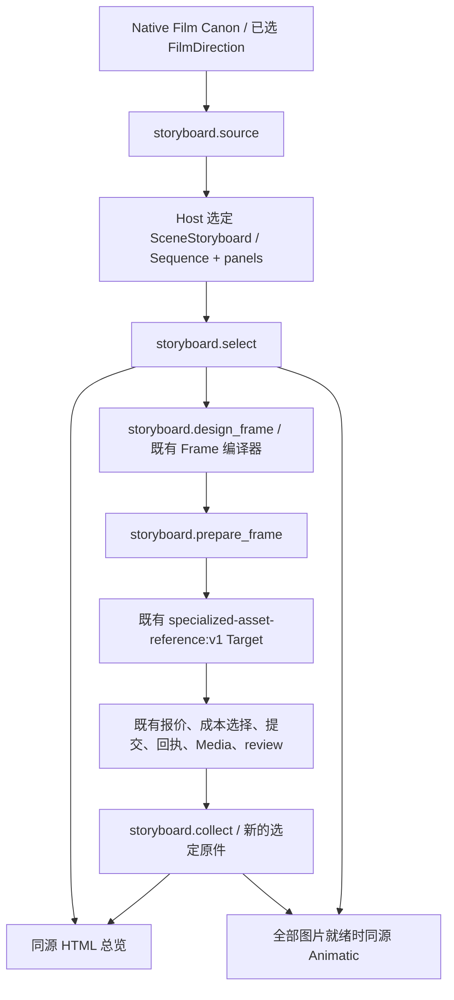

# 统一分镜工作流 P0 整合交付

2026-10-31。基于工作区 HEAD `e3ba1ae4717cc845a7f4fa016385f9b44df24515` 的未提交修改。边界：没有付费 API、正式 V6 Work/Run/采纳变更、MySQL/MinIO 写入、Blender、发布、服务重载或 commit/push。

## 结果

已将 Native Film 已选导演覆盖、分镜选择、已有图片 Target、场景总览和静态 Animatic 接成可复用入口。一个选择原件包含 Sequence 和其下画格，画格只保存必要的稳定身份、状态、节点时间及原件引用；已有 Frame 的 Reference 继续拥有资产身份、版本和用途。总览和 Animatic 从这份选择共同派生，没有第二张手工时间表。

这证明**原生入口及离线派生可用**。图片生产链走通的是明确标注的合成 transport/persistence 测试；没有用新付费图片、Seedance 视频或线上服务证明实际生产质量。静态 Animatic 的硬切换不代表实际摄影运动，也不代表未来视频必然跳变。

- [场景视觉总览（HTML，含播放器与可展开引用）](/Users/zy/historical-plugin/artifacts/unified-storyboard-p0-20261031/render/de79f110f0e27b14a4e300b4cdac5ff3de230f76a193e67228e7218b2ef1e1b7/index.html)
- [100 秒 Animatic](/Users/zy/historical-plugin/artifacts/unified-storyboard-p0-20261031/V6-01-animatic.mp4)
- [七画格速览](/Users/zy/historical-plugin/artifacts/unified-storyboard-p0-20261031/overview.png)
- [唯一选择输入](/Users/zy/historical-plugin/artifacts/unified-storyboard-p0-20261031/input.json)
- [时间、资产与原图验证证据](/Users/zy/historical-plugin/artifacts/unified-storyboard-p0-20261031/integration-validation.json)

## 正式调用链



`storyboard.source(run_id, scene_id)` 读取当前 Native Film checkpoint 中确切的 Canon、Direction 和 Shot 覆盖。不重新编剧，不自动发明画格或摄影方案。镜头时长来自既有导演 Shot；镜间关系仍使用现有 Sequence。初始连续桥是供选择的候选，Host 可明确改为省略、并行等关系及其理由，不将默认值当作已经观察到的连续性。

`storyboard.select` 将选择保存到现有 Markdown/创作原件机制所用的 immutable object store，并绑定 Native run 来源；返回明确 SourcePin 供后续工具继续使用。无 run 绑定的选择仅可用于隔离设计与预演，不能启动图片生产。没有新增 Runtime 阶段、全局“当前分镜”状态机或自动正式采纳。

`storyboard.design_frame` 使用既有 FrameSpec / PromptIR 编译路径。设计变化生成新选择，并清除该画格旧图的关联。`storyboard.prepare_frame` 把确切 Frame 绑定到既有图片 Target，而非新建分镜生成循环。之后使用现有 `specialized_assets.quote_reference`、成本决策、`resume_reference`、`review_reference`。缺少正式 Work 时不创建 Work，不为通过实验而进入生产。

生产结果使用现有 Media，purpose 为 `STORYBOARD_REFERENCE`；不注册为人物、场景或道具 Asset。原 Target 的 Asset 采纳/注册步骤对分镜结果不产生 Asset 副作用。准备、报价、未知结果恢复和回执机制继续由原 owner 负责。

`storyboard.collect` 核对原设计、作用域、review、输出哈希与 delivery，产生新的选择引用，并自动刷新总览；图片齐全时直接生成 Animatic。一个设计批次的多个结果可以依次收集，不要求 Host 重建时间线。`storyboard.render` 可以重新打开确切的历史选择；不会从最新原稿静默重写冻结结果。没有把分镜图自动采纳为 Seedance 首帧。

MCP 原有 `PluginToolAdapter` 按注册表导出这六个入口，未修改 Service。离线验证实际执行了 JSON 参数校验、类型转换与 source/select 调用：[MCP 证据](/Users/zy/historical-plugin/artifacts/unified-storyboard-p0-20261031/mcp-adapter-validation.json)。没有启动或重载线上 MCP。

## 关系、时间与资产

| 对象 | P0 中的责任 |
| --- | --- |
| Film Shot | Native Film 覆盖身份及既有 Sequence 顺序、时长 |
| Panel | 稳定 `key`、所属 `shot_key`、关键状态、镜头内 `at`、图片与 Frame 哈希引用 |
| 连续运动 | 仍由导演/专业原稿描述；多个 Panel 不能证明中间动作 |
| 剪辑点 | Shot 边界，与同镜内节点切换分别标记 |
| 图片生成单元 | 一个已选 Frame 的既有图片 Target；不是新的 Film Shot |
| 视频生成单元 | 本轮不改既有分解规则；未创建任何 Seedance 请求 |

资产不是从画面猜测。每格读取确切编译 Frame 中的 `entity_key/kind/asset_id/media_id/version/content_hash/facts/state`，核验参考文件实际字节。V6 原件未提供正式服务 ID 的地方继续保留原状，不伪造“已入库”身份。用途和状态来自既有 Reference；当前执行请求保持原编译内容，避免把引用清单另写一次。

有意时空跳跃沿用现有 Sequence 的关系和理由表达。新校验只处理重复身份、节点顺序、文件哈希和来源匹配，没有摄影运动配额、多画格配额或艺术评分。

## V6 七图离线结果

沿用原五镜时长 14 / 22 / 23 / 13 / 28 秒。02-b 在镜头内 12 秒、05-b 在镜头内 18 秒出现，是本轮隔离预演的显示选择，不是表演实测或正式新剪辑采纳。

| 画格 | 全场显示区间 | 关系 |
| --- | --- | --- |
| 01-a | 0–14 秒 | 第一镜 |
| 02-a | 14–26 秒 | 第二镜开始 |
| 02-b | 26–36 秒 | 第二镜内节点 |
| 03-a | 36–59 秒 | 第三镜开始 |
| 04-a | 59–72 秒 | 第四镜开始 |
| 05-a | 72–90 秒 | 第五镜开始 |
| 05-b | 90–100 秒 | 第五镜内节点 |

结果：5 镜 / 7 格 / 4 个镜间切点 / 100 秒；读取 22 条参考用途记录。每个显示区间中点抽取实际 MP4 画面，与七张原图分别比较，最近匹配均为正确画格。26 个输入文件（原图、Frame、共享参考及原时间线资料）的前后 SHA256 相同。速览图也按同一 `view.json` 排列并已查看。

没有修复原画面中缺车辆、水桶变化或 05-a/b 姿态差异；选择 notes 保留这些待处理问题。没有把静态对照称为连续声画观看验证。音轨明确为占位静音，`fullPlaybackReview` 与声音审阅仍未完成。

可直接使用 Plugin 通用 CLI 复现，无 V6 专用执行脚本：

```sh
cd /Users/zy/historical-plugin/drama-plugin
PYTHONDONTWRITEBYTECODE=1 PYTHONPATH=plugin/src .venv/bin/python \
  plugin/skills/shot-design/scripts/render_animatic.py \
  --selection /Users/zy/historical-plugin/artifacts/unified-storyboard-p0-20261031/input.json \
  --output /Users/zy/historical-plugin/artifacts/unified-storyboard-p0-20261031/render
```

旧 `SEQUENCE BOARDS SOURCES` 三输入 CLI 继续可用；新增单选择入口不要求旧作品迁移。局部改动形成新选择、沿已有 Shot/图像哈希复用未变部分；没有重新生成媒体素材。

## 实际修改文件

| 文件 | 改动 |
| --- | --- |
| [contracts/sequence.py](/Users/zy/historical-plugin/drama-plugin/plugin/src/drama_plugin/contracts/sequence.py) | 新增轻量 SceneStoryboard、Panel、文件证据；旧 Sequence 不加必填字段 |
| [film/storyboard.py](/Users/zy/historical-plugin/drama-plugin/plugin/src/drama_plugin/film/storyboard.py) | 原生 source/select/design/prepare/collect/render、来源绑定和同源派生 |
| [plugin.py](/Users/zy/historical-plugin/drama-plugin/plugin/src/drama_plugin/plugin.py) | 注册六工具；提供无 Provider 初始化的离线静态入口 |
| [reference_production.py](/Users/zy/historical-plugin/drama-plugin/plugin/src/drama_plugin/professional_design/reference_production.py) | 原图片 Target 接受分镜原件；共享回执/恢复，不产生 Asset 采纳 |
| [render_animatic.py](/Users/zy/historical-plugin/drama-plugin/plugin/skills/shot-design/scripts/render_animatic.py) | 通用 `--selection` 入口，保留旧参数 |
| [Director Skill](/Users/zy/historical-plugin/drama-plugin/plugin/skills/director/SKILL.md) | 指向原生选择和观看节点责任 |
| [Shot Design Skill](/Users/zy/historical-plugin/drama-plugin/plugin/skills/shot-design/SKILL.md) | 编译、图片 Target、选择与派生交接 |
| [工作流说明](/Users/zy/historical-plugin/drama-plugin/plugin/docs/director-storyboard-animatic.md) | 工具顺序、恢复、费用与证据边界 |
| [test_native_storyboard.py](/Users/zy/historical-plugin/drama-plugin/plugin/tests/test_native_storyboard.py) | 实际本地渲染、原生注册、恢复、来源隔离、Target 完成与收集测试 |

另新增本交付报告；实验产物在独立 artifacts 目录。本轮没有修改 Knowledge 内容；缓存对齐包含工作区先前已经完成的 Knowledge 版本。

## 测试与安装一致性

- 相关回归：**86 passed，1 deselected**，[日志](/Users/zy/historical-plugin/artifacts/unified-storyboard-p0-20261031/regression-final.txt)。覆盖分镜、Sequence、Native Film、资产引用角色/选择及既有图片 Target。
- 最后补充的 MCP 类型解析与 Skill 引用验证：**8 passed**，[日志](/Users/zy/historical-plugin/artifacts/unified-storyboard-p0-20261031/focused-final.txt)。并实际经过原 MCP adapter 的 JSON 调用。
- 未计为通过的一项：`test_formal_reference_artist_receives_selected_design_and_projects_ids`。其预期 MockTransport 与既有 Host-first 缺原稿行为冲突；在干净 HEAD 解包上同样失败，[基线日志](/Users/zy/historical-plugin/artifacts/unified-storyboard-p0-20261031/baseline-test.txt)。没有借本轮修改作者策略。
- 新图片 Target 全程测试明确使用 synthetic transport/Media fixture；走过报价选择、提交、review、成功、结果选择与自动 Animatic，并断言未创建 Asset、无 adoption。它不是付费模型或线上存储证据。
- 安装缓存同步：56 个源码、34 个 Skill 文件、55 个 Knowledge 文件、6 个文档，共 **151 个差异文件**。这是累计版本落后，不是本轮新增 151 项功能。逐文件校验并保留旧文件备份；未复制配置、认证、生产状态或修改插件版本清单。[清单](/Users/zy/historical-plugin/artifacts/unified-storyboard-p0-20261031/cache-sync-plan.json)；[结果及备份位置](/Users/zy/historical-plugin/artifacts/unified-storyboard-p0-20261031/cache-sync-result.json)。
- 从安装缓存源码启动的新测试进程：**7 passed**，[日志](/Users/zy/historical-plugin/artifacts/unified-storyboard-p0-20261031/cache-tests.txt)。缓存 CLI 重放结果与工作区 JSON 完全一致，[实际导入路径及比对](/Users/zy/historical-plugin/artifacts/unified-storyboard-p0-20261031/cache-import-validation.json)。
- 正在运行的 MCP 进程没有重启，因此不能将缓存同步称为已运行服务完成热更新。当前新进程可以加载；既有进程是否采用新版本须由正常生命周期加载确认。

## 遗留 P1

1. **真正动态预演与声音时间**：当前按节点停留，不插值摄影机/演员运动；连续对白、音乐母带和实际声音 cue 尚未接入本次静态输出。应扩展既有 Animatic/声音 owner，而非增加新生产循环。
2. **Seedance 输出回链**：已有视频执行 owner 保持不变；分镜 `productionRef` 回链了图片 Target。视频成片到具体 panel/节点区间的可观察偏差和局部视频修订，仍需在现有视频来源/审阅关系中补齐，不能声称本轮已经验证。
3. **真实图片生产与线上交付**：复用了生产路径并做离线端到端回归；未实际调用付费生成或线上 Media/MinIO。未来授权生产应验证同一绑定请求和结果回读，不根据离线成功推断模型执行质量。
4. **原画面的艺术与连续性缺陷**：本轮使其可同时查看与定位，没有修图或自动重新创作。后续由 Host 在已有 Owner 中选择局部修订。
5. **更丰富的空间/运动展示**：当前 HTML 是现有预演的可读派生产物，没有拖拽编辑、独立 Canvas、Blender 或新的资产管理界面。必要图形/声音节点应继续派生自同一已选原稿。

本轮在交付处停止，不继续生成或采纳任何正式媒体。
